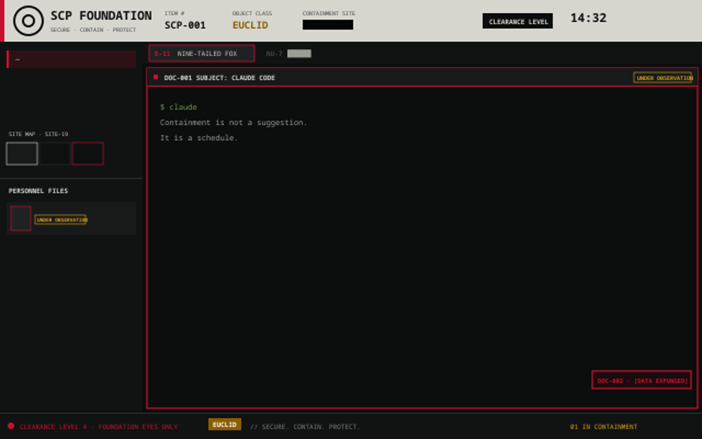

# SCP Foundation: a Herdr layout

A dark terminal layout dressed as a Foundation containment console: a paper document header, redaction bars with clearance levels, personnel files for agents, Mobile Task Force tab names, an incident log, a keycard login and department themes.

See [RECIPE.md](RECIPE.md) for everything it does and how it is built.

## Install

Copy `layouts/`, `mods/` and `themes/` into `~/.config/herdr-app/`, merge `keys.json` into yours, then run `herdr-app do layout.switch --name scp-foundation`.

## Credits and licence

- This is unofficial fan content. It is not made by, endorsed by or affiliated with the SCP Foundation wiki or its authors.
- The Foundation emblem (`mods/scp/emblem.svg`) is from Wikimedia Commons and is licensed CC BY-SA 3.0. SCP Foundation content is CC BY-SA 3.0 as well.
- The shipped Herdr mods `tabs`, `toast` and `spaces` were cloned and restyled as `scp-tabs`, `scp-toast` and `scp-spaces`. They belong to Herdr and are not updated with it.
- The Content Archives window (Ctrl+Alt+W) fetches SCP Wiki articles live from scp-wiki.wikidot.com (CC BY-SA 3.0; authorship is on each article page) and shows the title, class, rating, containment procedures, description and first pictures. Nothing from the wiki is included in this repo; it is cached on your computer only.
- The sounds in `mods/scp/sounds/` are simple tones generated with ffmpeg.
- Everything else here (layout, `scp` mod, themes) is released under CC BY-SA 3.0, to match the emblem.
