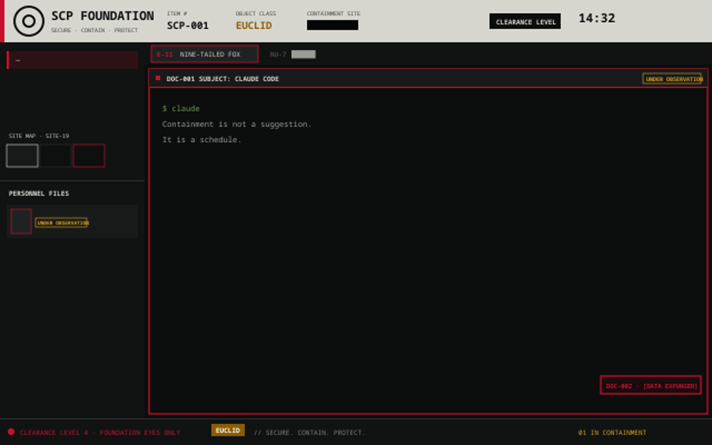

# SCP Foundation

A dark terminal layout dressed as a Foundation containment console. A paper-colored document header carries the emblem and the item, class and site fields; panes are "documents" with redaction bars; agents are personnel files; tabs are Mobile Task Force units; finished work is logged as incidents.

## What you see

- **Header (62px, paper `#d6d6cf`, red edge `#c8102e`):** emblem, `SCP FOUNDATION`, ITEM # (`SCP-nnn` from the space's index), OBJECT CLASS of the shown site, two redacted fields, a DEPT chip, a CLEARANCE chip, the time with `SITE-19 · DAY nnn`, a settings gear (opens `app.settings`), and window buttons.
- **Sidebar (290px):** Containment Sites list (square corners; each site is a file: the emblem in its object-class colour, `SCP-nnn` and its name (blacked out below clearance 3), its state and subject count, an object-class chip, and the icons of its agents; a breach blinks; a marker in the department colour shows the shown site), a Machines panel (`THIS COMPUTER` plus each remote machine from `hc machine ls`, with state, space and agent counts, a `+` for a new space there and `+ ADD MACHINE`, which opens Settings > Machines; 62px, scrolls when you add remotes), a quick-actions strip (DRILL, REPORT, DEPT, ARCHIVE buttons), Recent Incidents (the last four log lines, click to open the archive), a Site Map (one `S-nn` sector per space, coloured by class, with a floor plan of its shown tab: one tile per pane with the program icon, outlined by status, white on the focused pane; click a tile to jump to that pane. Tiles are laid out Hyprland-dwindle style, an approximation because Herdr does not expose split geometry to mods), and Personnel Files (an empty list offers `+ CLAUDE`-style start buttons from `knownAgents()` plus `+ TERMINAL`; one file per agent: photo box, `ID`, `MTF` unit, status stamp, redacted site, `FILE` button).
- **Tabs (30px):** each tab is a unit, `E-11 NINE-TAILED FOX`, `NU-7`, `A-1`, ... A tab you named shows `<code> <name>`.
- **Panes:** square frames, red focus border, a document header per pane (`DOC-nnn`, `SUBJECT:`, `MTF` chip, redacted path, status stamp). Idle unfocused panes get a floating `[DATA EXPUNGED]` stamp.
- **Agent dock (right, 200px):** every agent Herdr knows (`knownAgents()`), installed ones first with a READY or IN CONTAINMENT line, the rest dimmed as NOT INSTALLED. A click tiles the agent beside the focused pane (right, then down, alternating, like a Hyprland dwindle layout); a right-click opens it as a new tab.
- **Footer (26px):** clearance text, object-class chip, a branch chip (the shown space's git branch, hidden outside a repo), then the latest incident or a rotating notice, an INCIDENT ARCHIVE button and subject counts.

## How it behaves

- **Statuses:** working = `UNDER OBSERVATION` (amber), blocked = `BREACH` (red, blinking; the pane header turns dark red with a `COGNITOHAZARD` strip and the header shows a breach banner), done = `RECONTAINED` (green), idle = `CONTAINED`.
- **Clearance 1 to 5** (click the chip, or `scp.cycle`): redaction bars declassify on hover only if your level reaches the bar's level; level 5 shows everything. Below 3 a tab's own name is redacted, at 1 the callsign too. Hovering a bar you may not open and clicking it plays a denied sound. A change shows a footer banner.
- **Incidents:** agents entering, breaching and recontaining are logged (last 80). `scp.archive` opens the Incident Archive (LOG or INTERVIEW view, FILE REPORT writes `reports/incident-report-<time>.txt`).
- **Content Archives (`scp.wiki`, WIKI button):** the SCP wiki's Series 1 list with range tabs, filter, RECENT and ★ SAVED; an article shows Item #, Object Class, rating, pictures, containment procedures (clearance 2 to read) and description (clearance 3), blacked out word for word below that. State: shared `scp.wiki.fav`, `scp.wiki.recent`.
- **Windows:** ITEM # opens the Special Containment Procedures article; a dossier opens from a personnel file's `FILE` button; closing a terminal pane opens a Termination Order (Enter/Esc).
- **Login:** a typed boot screen with a keycard scan, at most once per 30 minutes.
- **Drill:** `scp.drill` stages a 20-second fake breach.
- **Departments:** the DEPT chip (or `scp.dept`) cycles 14: Foundation (red), MTF Tactical (green), Ethics Committee (blue), O5 Council (gold, dark), Overwatch (steel), Internal Security (purple), Tactical Response (orange), Recovery (teal), Security (navy), Abnormal Tech (cyan, dark), Temporal (violet, dark), Disinformation (magenta), Medical (brown) and Research (mustard). It recolors the whole UI: the terminal theme, the accent, and the paper of headers, windows and memo toasts (O5 turns the paper dark with gold ink). The choice is kept in shared `scp.dept`.
- **Keys** (`keys.json`, global): ctrl-alt-c cycle, -i archive, -p article, -l login, -d drill, -r report, -t department, -w wiki (Content Archives). ctrl+alt is AltGr on Windows.
- **Sounds** (`mods/scp/sounds/*.mp3`, generated with ffmpeg tones): breach, contained, tick, stamp, terminate, archive, login, denied.

## Built from

- `layouts/scp-foundation.json`: root column (`titlebar: none`, theme `scp-foundation`, JetBrains Mono / Geist, `toast: scp-toast`, `preview`), `header` (62px, `window_drag`), `body` row: `sidebar` column (`spaces` = `scp-spaces`, `machines` = scp role `machines` at 62px, `actions` = scp role `actions` at 30px, `incidents` = scp role `incidents` at 104px, `sitemap`, `agents` = scp role `personnel`) and `work` column (`tabs` = `scp-tabs`, `work-body` row of `main`, a hidden `panel` stack and the `dock` (scp role `dock`, 200px) with Herdr's `files` and `changes`), `footer` 26px. Pane frames: `lone`, radius 0, header `{mod: scp, role: pane}`, floating `stamps` block.
- `mods/scp`: one `View` with roles header, footer, pane, personnel, sitemap, stamp, terminate, archive, article, dossier, login (`props.role`). `mtf.js` maps an agent address to a unit. Shared state: `scp.clearance`, `scp.log`, `scp.loginAt`, `scp.drill`, `scp.seen`, `scp.dept`. Uses `agents()`, `spaces()`, `panes()`, `run`, `openOverlay`, `nextCommand`, `playSound`, `exec` (only `mkdir -p` for the reports folder), `writeTextFile`, `notify`.
- `mods/scp-tabs`: Herdr's `tabs` mod cloned; labels, square chips, clearance redaction.
- `mods/scp-toast`: Herdr's `toast` mod cloned; notifications as memos.
- `mods/scp-spaces`: Herdr's `spaces` mod cloned with square corners.
- `themes/scp-foundation.json` (bg `#0c0d0d`, fg `#d6d6cf`, accent `#c8102e`) plus one theme per other department (`scp-mtf`, `scp-ethics`, `scp-o5`, `scp-overwatch`, `scp-internal`, `scp-tactical`, `scp-recovery`, `scp-security`, `scp-tech`, `scp-temporal`, `scp-disinfo`, `scp-medical`, `scp-research`).
- Network: only the Content Archives window (`scp.wiki`) fetches, from scp-wiki.wikidot.com, on demand (the index, an article, its first two pictures, saved under `cache/wiki/`). Nothing from the wiki is shipped. The emblem `mods/scp/emblem.svg` is from Wikimedia Commons (CC BY-SA 3.0); credit it if you share this.

## Watch out

- The shipped mods were cloned from Herdr 0.1.x; a newer Herdr will not update the clones.
- Layout `scp-foundation` needs the hidden `panel` stack or the Files/Changes buttons error with "no node 'panel'".
- Only the root theme applies, so a department switch runs `app.theme` for the terminal and the scp mod repaints its own colors (`applyDept()` at every render). The scp-toast mod keeps its own copy of the department palettes; keep both in step if you change one.
- Stamps are not rotated (no rotation support). The `stamp` sound plays when a new stamp appears.
- The cognitohazard mode only styles the pane header; it does not scramble the terminal.
- Mod commands (`scp.drill` and the rest) come from `keys.json` or `herdr-app do scp.<name>`.

## Done when

- `herdr-app check mods/scp mods/scp-tabs mods/scp-toast mods/scp-spaces` all pass and `herdr-app status` shows `"errors": []`.
- `layout.switch scp-foundation` shows the paper header, site map and footer.
- `herdr-app do scp.drill` shows a breach banner for about 20 seconds, then a "DRILL COMPLETE" incident.
- `herdr-app do scp.report` creates a file under `reports/` and shows a memo toast.
- Cycling clearance to 1 turns tab names into block characters.
